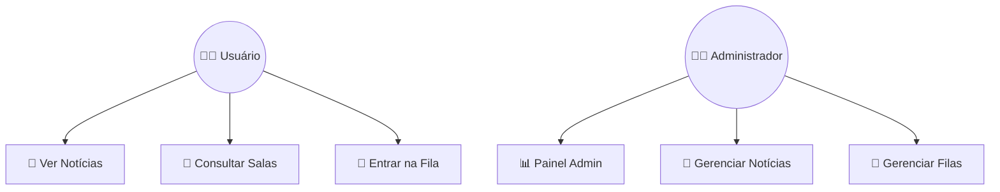
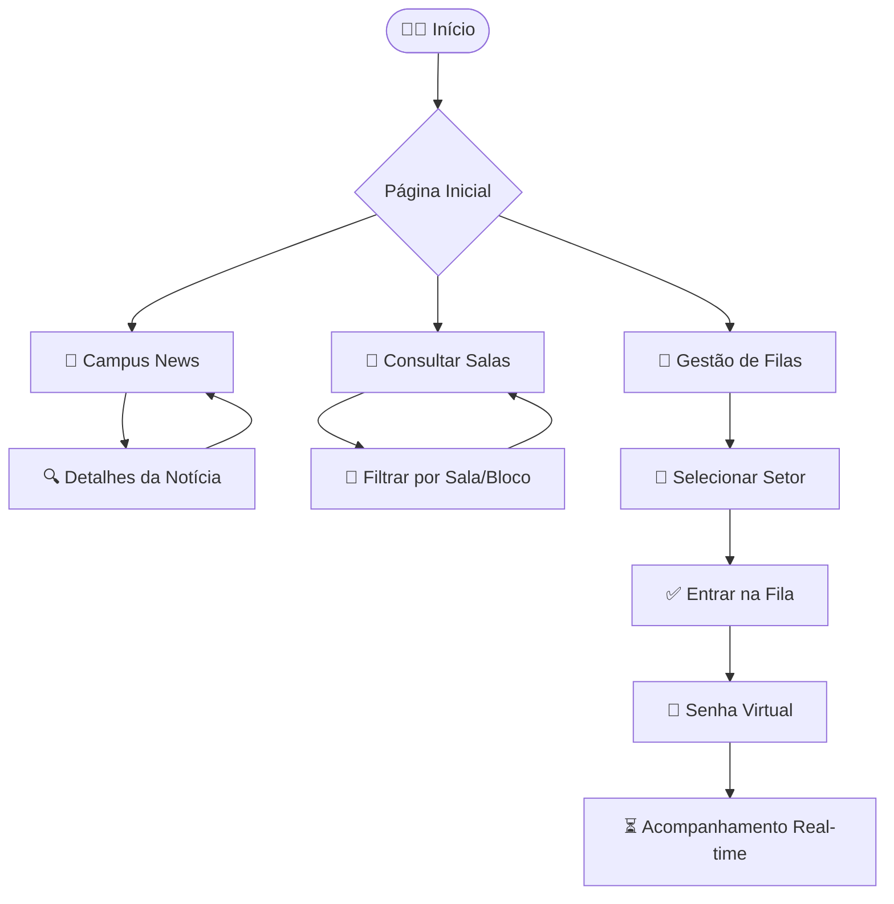

# Campus News - Portal Inteligente Institucional com Gestão de Fluxo Acadêmico

App web + mobile a partir do protótipo [Campus-News](https://github.com/Shakaos/Campus-News).

## Como executar

Este PC usa Node.js portátil em `%USERPROFILE%\.local\node` (a instalação pelo Windows foi cancelada). No PowerShell:

```powershell
$env:PATH = "$env:USERPROFILE\.local\node;$env:PATH"
cd $env:USERPROFILE\Campus-News-App
npm install
npm run dev
```

Abra `http://localhost:4173`.

### Web (PWA)

O build gera um app instalável no Chrome/Edge (menu **Instalar Campus News**).

```powershell
npm run build
npm run preview
```

### Arquivos enviados nos trabalhos

Os anexos dos alunos são armazenados em um bucket privado do Supabase Storage. Crie um bucket chamado `assignment-submissions` (ou defina `SUPABASE_ASSIGNMENTS_BUCKET`) e configure estas variáveis somente no ambiente do servidor:

```text
SUPABASE_URL=...
SUPABASE_SERVICE_ROLE_KEY=...
SUPABASE_ASSIGNMENTS_BUCKET=assignment-submissions
```

Não coloque `SUPABASE_SERVICE_ROLE_KEY` em variáveis `VITE_*` nem no código do navegador. O servidor cria a tabela de metadados dos anexos ao iniciar; os arquivos ficam no bucket privado e são acessados por links temporários autenticados.

### Android

#### Publicar a versão web/API no Render

1. Envie as alterações para a branch `main` do GitHub.
2. No Render, crie um **Blueprint** a partir do repositório e confirme o serviço definido em `render.yaml`.
3. Aguarde o deploy e teste `https://SEU-SERVICO.onrender.com/api/health`.
4. Copie a URL pública do serviço; ela será usada ao gerar o APK.

O plano gratuito do Render pode suspender o serviço quando estiver ocioso e o banco SQLite de demonstração não é persistente: dados de teste podem ser apagados quando a instância reiniciar ou for implantada novamente. Não use dados reais de alunos.

Para habilitar o envio de anexos de trabalhos, configure no serviço Render `SUPABASE_URL`, `SUPABASE_SERVICE_ROLE_KEY` e `SUPABASE_ASSIGNMENTS_BUCKET=assignment-submissions`. O bucket `assignment-submissions` deve existir como privado no Supabase. Nunca exponha a chave `SUPABASE_SERVICE_ROLE_KEY` no app.

#### Gerar e disponibilizar o APK Android

Após o serviço Render estar online:

1. Abra **Actions → Android APK → Run workflow** no GitHub.
2. Informe a URL da API terminando em `/api` e uma nova tag de release, por exemplo `demo-2026-11-09`.
3. O workflow compila e publica o APK em **Releases**. Envie ao professor o link do arquivo `app-debug.apk`.
4. No Android, baixe e instale o APK. O Android pode pedir autorização para instalar apps baixados pelo navegador.

O APK de demonstração é assinado para debug e distribuído fora da Play Store; não é uma publicação para produção. A versão web/PWA também pode ser aberta no Chrome Android e instalada pelo menu do navegador.

```powershell
npm run mobile:android
```

Isso gera o `dist`, sincroniza o Capacitor e abre o projeto nativo local. Para compilar localmente, instale o [Android Studio](https://developer.android.com/studio) e o Android SDK.

### iOS

O código iOS fica pronto, mas **só compila em um Mac** com Xcode:

```bash
npm run mobile:ios
```

### Cadastro e logins de demonstração

O cadastro público está desativado. A administração da instituição cria contas de alunos e professores na área **Administração**; os usuários devem solicitar acesso à secretaria.

Em produção, defina `INITIAL_ADMIN_EMAIL` e `INITIAL_ADMIN_PASSWORD` (mínimo de 12 caracteres) no ambiente do servidor para criar a conta inicial de administrador. As contas de demonstração abaixo funcionam somente em desenvolvimento local; são desativadas em produção.

### Organização acadêmica

Antes de cadastrar alunos, abra **Administração > Cursos e turmas**:

1. Cadastre cada curso oferecido pela instituição.
2. Confira o semestre letivo atual no formato `AAAA/1` ou `AAAA/2`.
3. Cadastre as contas dos professores na aba **Professores**.
4. Cadastre cada turma/disciplina indicando curso, período curricular, grupo (por exemplo, A), professor e horário.
5. Ao cadastrar um aluno, selecione o curso, o período e o grupo correspondentes.

O aluno verá apenas disciplinas do seu curso, período, grupo e semestre letivo atual. O professor verá apenas as turmas que a administração lhe atribuiu, incluindo curso, período e grupo. O “período do curso” (por exemplo, 3º período) é separado do bimestre usado para notas. Matrículas em disciplinas de outros períodos não são permitidas por este fluxo.

| Perfil | Usuário | Senha |
| --- | --- | --- |
| Administrador | `admin@campus.edu` | `admin123` |
| Professor | `professor@campus.edu` | `prof123` |
| Aluno | `aluno@campus.edu` | `aluno123` |

---

## Parte 1 – Rascunho Digital

### Base do Projeto
- **Nome Oficial:** Campus News - Portal Inteligente Institucional com Gestão de Fluxo Acadêmico
- **Nome Comercial Sugerido:** UniFlow ou Portal Acadêmico Inteligente.
- **Frase de Propósito:** "Conectando o campus, otimizando o tempo e simplificando a vida acadêmica."

### Identidade Visual Inicial
- **Paleta de Cores (Tema Claro Refinado):**
  - Fundo Principal: `#F1F5F9` (Slate 100)
  - Superfícies: `#FFFFFF` (Branco)
  - Texto Principal: `#0F172A` (Slate 900)
  - Azul Darker: `#1D4ED8` (Blue 700)
  - Erro: `#DC2626` (Red 600)
- **Estilo:** Moderno, minimalista, com bordas arredondadas (24px-32px) para um toque amigável e contemporâneo.
- **Tipografia:** Inter (Sans-serif) para legibilidade em telas mobile. JetBrains Mono para dados técnicos e senhas.

### Fluxo do Sistema
1. **Acesso:** Aluno escaneia QR Code espalhado pelo campus.
2. **Splash/Entrada:** Carregamento rápido da marca.
3. **Home:** Escolha entre os 3 módulos principais.
4. **Módulo 1 (Jornal):** Lista de notícias -> Detalhe da notícia -> Inscrição (se evento).
5. **Módulo 2 (Salas):** Filtro -> Lista de resultados -> Status em tempo real.
6. **Módulo 3 (Filas):** Seleção de setor -> Confirmação -> Acompanhamento em tempo real.

### Diagramas do Sistema

#### Diagrama de Casos de Uso


#### Fluxograma do Usuário


---

## Parte 2 – Protótipo Final

### Funcionalidades Detalhadas
- **Centralização de Comunicados:** Feed dinâmico com categorias coloridas. Marcadores de "Urgente" para avisos críticos.
- **Consulta de Salas:** Integração com dados de horários. Filtros por bloco e nome. Status visual (Verde/Laranja/Vermelho).
- **Gestão de Filas:** Algoritmo de média móvel para estimativa de tempo. Senha virtual com posição em tempo real.
- **Dados Analíticos:** Dashboard administrativo com gráficos de tendência e horários de pico para melhor alocação de recursos.

### Diferenciais
1. **Ecossistema Único:** Resolve três problemas distintos em uma única interface progressiva.
2. **Acessibilidade:** Design focado em alto contraste (WCAG AA) e navegação simplificada.
3. **Tomada de Decisão:** Dados reais de fluxo ajudam a administração a otimizar o atendimento.

---

## Guia Rápido para Figma
1. **Componentes:** Crie componentes para `ModuleCard`, `NewsCard`, `RoomItem` e `StatusBadge`.
2. **Auto Layout:** Use Auto Layout em todos os containers com espaçamento de 16px ou 24px.
3. **Frames:** Utilize frames de `375x812` (iPhone 13 mini/11 Pro) para o design mobile-first.
4. **Interações:** Configure transições de "Slide In" para navegação entre telas e "Smart Animate" para o dashboard.
